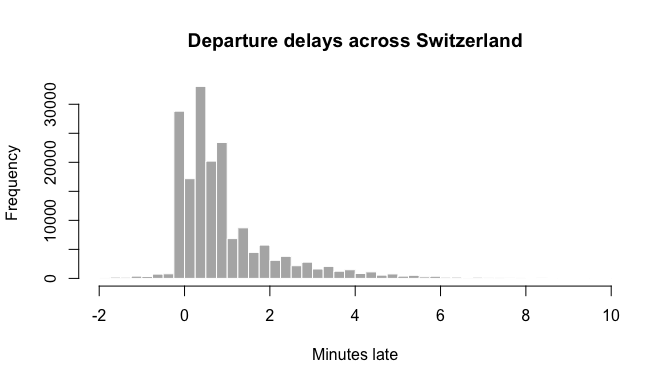

<!--
This article is precomputed: it needs an API key, protoc and the network,
which neither CRAN nor CI has. Edit gtfs-rt.Rmd.orig, never gtfs-rt.Rmd, and
re-knit from the package root with zuproto installed:

  Rscript -e 'setwd("vignettes/articles"); knitr::knit("gtfs-rt.Rmd.orig", "gtfs-rt.Rmd")'

The key is read from OPENTRANSPORTDATA_API_KEY. The feed allows two requests
a minute per key, and a knit makes one.
-->


[GTFS Realtime](https://gtfs.org/documentation/realtime/reference/) is the
format transit agencies use to publish live data: delays, cancellations,
alerts. It is plain Protocol Buffers. This article reads the live feed of
all public transport in Switzerland, from
[opentransportdata.swiss](https://opentransportdata.swiss/), and turns it
into tables of trips and stop delays.

The output below comes from a run on 27 October 2026 at 15:36 CET.
The code is not run when the site is built.


``` r
library(zuproto)
```

## What you need

- **An API key.** Register at opentransportdata.swiss and subscribe to the
  GTFS Realtime API in its API Manager. Put the key in `.Renviron`, so it
  stays out of your code:

  ```sh
  OPENTRANSPORTDATA_API_KEY=<your key>
  ```

- **`protoc`**, the protobuf compiler, to turn the schema into a descriptor
  set. zuproto itself does not need it. On macOS, `brew install protobuf`;
  on Debian and Ubuntu, `apt install protobuf-compiler`.

## The schema

The schema is `gtfs-realtime.proto`, from Google's
[transit](https://github.com/google/transit) repository. zuproto does not
read `.proto` files. It reads a *descriptor set*: the schema already
compiled into protobuf's own binary format. `protoc` makes one with
`--descriptor_set_out`. `buf build -o gtfs-realtime.binpb` works too.

You only need to do this once. The descriptor set is a small file you can
keep next to your code and reuse, and only it is needed from then on.


``` r
dir <- tempfile("gtfs-rt-")
dir.create(dir)
proto <- file.path(dir, "gtfs-realtime.proto")
desc <- file.path(dir, "gtfs-realtime.binpb")

download.file(
  paste0(
    "https://raw.githubusercontent.com/google/transit/",
    "474750a163088673df718838d4a1bb093391f9af/",
    "gtfs-realtime/proto/gtfs-realtime.proto"
  ),
  proto,
  quiet = TRUE
)
system2("protoc", c(
  paste0("--proto_path=", dir),
  paste0("--descriptor_set_out=", desc),
  proto
))
```

`desc` is now the path to `gtfs-realtime.binpb`, a file of about 10 KB.
`proto_pool()` loads it into a pool, which holds the message types that
zuproto decodes. The GTFS Realtime types join the well-known types every
pool starts with.


``` r
pool <- proto_pool(desc)
pool
#> <proto_pool: 12 files, 89 message types>
proto_fields(pool, "transit_realtime.TripUpdate")
#>               name number    type    label
#> 1             trip      1 message required
#> 2          vehicle      3 message optional
#> 3 stop_time_update      2 message repeated
#> 4        timestamp      4  uint64 optional
#> 5            delay      5   int32 optional
#> 6  trip_properties      6 message optional
#>                                    type_name oneof      json_name presence
#> 1            transit_realtime.TripDescriptor  <NA>           trip     TRUE
#> 2         transit_realtime.VehicleDescriptor  <NA>        vehicle     TRUE
#> 3 transit_realtime.TripUpdate.StopTimeUpdate  <NA> stopTimeUpdate    FALSE
#> 4                                       <NA>  <NA>      timestamp     TRUE
#> 5                                       <NA>  <NA>          delay     TRUE
#> 6 transit_realtime.TripUpdate.TripProperties  <NA> tripProperties     TRUE
#>   packed   map extension
#> 1  FALSE FALSE     FALSE
#> 2  FALSE FALSE     FALSE
#> 3  FALSE FALSE     FALSE
#> 4  FALSE FALSE     FALSE
#> 5  FALSE FALSE     FALSE
#> 6  FALSE FALSE     FALSE
```

## The feed

The trip updates feed is one `FeedMessage` covering the whole country. The
key goes in an `Authorization` header.


``` r
feed <- file.path(dir, "trip-updates.binpb")
download.file(
  "https://api.opentransportdata.swiss/la/gtfs-rt",
  feed,
  mode = "wb",
  quiet = TRUE,
  headers = c(
    Authorization = paste("Bearer", Sys.getenv("OPENTRANSPORTDATA_API_KEY"))
  )
)
file.size(feed)
#> [1] 9402533
```

## One message as a list

`proto_decode()` turns the message into a named list. Enums become factors,
and fields the feed does not set are left out.


``` r
msg <- proto_decode(feed, "transit_realtime.FeedMessage", pool)
str(msg$header)
#> List of 4
#>  $ gtfs_realtime_version: chr "2.0"
#>  $ incrementality       : Factor w/ 2 levels "FULL_DATASET",..: 1
#>  $ timestamp            : num 1.79e+09
#>  $ feed_version         : chr "20261024"
```

The header's `timestamp` is POSIX time, as a `uint64`. It is not a
well-known `Timestamp`, so zuproto leaves it as a number:


``` r
.POSIXct(msg$header$timestamp, tz = "Europe/Zurich")
#> [1] "2026-10-27 15:36:18 CET"
```

`feed_version` names the GTFS static release that the trip and stop IDs
refer to.

Each element of `entity` is one trip:


``` r
length(msg$entity)
#> [1] 15576
str(msg$entity[[1]])
#> List of 2
#>  $ id         : chr ".ojp-91-71A.1.TA.117.j26|20261027"
#>  $ trip_update:List of 2
#>   ..$ trip            :List of 5
#>   .. ..$ trip_id              : chr ".ojp-91-71A.1.TA.117.j26"
#>   .. ..$ route_id             : chr "91-71A-j26-1"
#>   .. ..$ start_time           : chr "06:57:00"
#>   .. ..$ start_date           : chr "20261027"
#>   .. ..$ schedule_relationship: Factor w/ 8 levels "SCHEDULED","ADDED",..: 1
#>   ..$ stop_time_update:List of 1
#>   .. ..$ :List of 4
#>   .. .. ..$ stop_sequence        : num 1
#>   .. .. ..$ stop_id              : chr "8775605"
#>   .. .. ..$ departure            :List of 1
#>   .. .. .. ..$ delay: int 0
#>   .. .. ..$ schedule_relationship: Factor w/ 4 levels "SCHEDULED","SKIPPED",..: 1
```

## Trips as a data frame

A list of 15,000 trips is awkward to work with.
`proto_decode_df()` with `field = "entity"` makes the repeated `entity`
field the rows of a data frame. Nested messages become data frame columns,
built column by column in C.


``` r
system.time(
  entities <- proto_decode_df(
    feed,
    "transit_realtime.FeedMessage",
    pool,
    field = "entity"
  )
)
#>    user  system elapsed 
#>   0.662   0.015   0.678
trips <- entities$trip_update
head(trips$trip[c("trip_id", "route_id", "start_time")])
#>                     trip_id     route_id start_time
#> 1  .ojp-91-71A.1.TA.117.j26 91-71A-j26-1   06:57:00
#> 2  .ojp-91-71A.1.TA.136.j26 91-71A-j26-1   06:57:00
#> 3 .ojp-92-9-L.1.TA.1895.j26 92-9-L-j26-1   08:41:00
#> 4 .ojp-92-9-L.1.TA.5119.j26 92-9-L-j26-1   09:45:00
#> 5 .ojp-91-1-D.1.TA.2450.j26 91-1-D-j26-1   11:07:00
#> 6  .ojp-91-71B.1.TA.143.j26 91-71B-j26-1   11:15:00
```

`schedule_relationship` is a factor, so counting cancelled and added trips
is a `table()`:


``` r
table(trips$trip$schedule_relationship)
#> 
#>   SCHEDULED       ADDED UNSCHEDULED    CANCELED REPLACEMENT  DUPLICATED 
#>       15187         245           0         144           0           0 
#>     DELETED         NEW 
#>           0           0
```

## Delays at each stop

`stop_time_update` is a repeated message, so each row holds a data frame
of that trip's stops. Swiss stop IDs are mostly SLOIDs
(`ch:1:sloid:…`), with some older numeric IDs.


``` r
str(trips$stop_time_update[[3]])
#> 'data.frame':	30 obs. of  7 variables:
#>  $ stop_sequence             : num  1 2 3 4 5 6 7 8 9 11 ...
#>  $ stop_id                   : chr  "ch:1:sloid:9321:0:714096" "ch:1:sloid:9319:0:585873" "ch:1:sloid:9315:0:466337" "ch:1:sloid:92711:0:37662" ...
#>  $ arrival                   :'data.frame':	30 obs. of  4 variables:
#>   ..$ delay         : int  NA 21882 21888 21864 21912 21864 21894 21870 21846 21840 ...
#>   ..$ time          : num  NA NA NA NA NA NA NA NA NA NA ...
#>   ..$ uncertainty   : int  NA NA NA NA NA NA NA NA NA NA ...
#>   ..$ scheduled_time: num  NA NA NA NA NA NA NA NA NA NA ...
#>  $ departure                 :'data.frame':	30 obs. of  4 variables:
#>   ..$ delay         : int  21900 21882 21888 21864 21912 21864 21894 21870 21846 21840 ...
#>   ..$ time          : num  NA NA NA NA NA NA NA NA NA NA ...
#>   ..$ uncertainty   : int  NA NA NA NA NA NA NA NA NA NA ...
#>   ..$ scheduled_time: num  NA NA NA NA NA NA NA NA NA NA ...
#>  $ departure_occupancy_status: Factor w/ 9 levels "EMPTY","MANY_SEATS_AVAILABLE",..: NA NA NA NA NA NA NA NA NA NA ...
#>  $ schedule_relationship     : Factor w/ 4 levels "SCHEDULED","SKIPPED",..: 1 1 1 1 1 1 1 1 1 1 ...
#>  $ stop_time_properties      : logi  NA NA NA NA NA NA ...
```

A message field that no stop of a trip sets, such as `arrival` at a
first stop, is an all-`NA` column rather than a data frame. A small helper
covers both cases when pulling out the delays:


``` r
delay <- function(stops, event) {
  x <- stops[[event]]
  if (is.data.frame(x)) x$delay else rep(NA_integer_, nrow(stops))
}

updates <- trips$stop_time_update
n <- vapply(updates, nrow, integer(1))
stops <- data.frame(
  trip_id = rep(trips$trip$trip_id, n),
  stop_id = unlist(lapply(updates, `[[`, "stop_id")),
  arrival_delay = unlist(lapply(updates, delay, "arrival")),
  departure_delay = unlist(lapply(updates, delay, "departure"))
)
nrow(stops)
#> [1] 190161
head(stops)
#>                     trip_id                  stop_id arrival_delay
#> 1  .ojp-91-71A.1.TA.117.j26                  8775605            NA
#> 2  .ojp-91-71A.1.TA.136.j26                  8775605            NA
#> 3 .ojp-92-9-L.1.TA.1895.j26 ch:1:sloid:9321:0:714096            NA
#> 4 .ojp-92-9-L.1.TA.1895.j26 ch:1:sloid:9319:0:585873         21882
#> 5 .ojp-92-9-L.1.TA.1895.j26 ch:1:sloid:9315:0:466337         21888
#> 6 .ojp-92-9-L.1.TA.1895.j26 ch:1:sloid:92711:0:37662         21864
#>   departure_delay
#> 1               0
#> 2               0
#> 3           21900
#> 4           21882
#> 5           21888
#> 6           21864
```

Delays are in seconds. Most departures are within a minute or two of
schedule:


``` r
quantile(stops$departure_delay, c(0.5, 0.9, 0.99), na.rm = TRUE)
#> 50% 90% 99% 
#>  36 162 432
```


``` r
minutes <- stops$departure_delay / 60
minutes <- minutes[!is.na(minutes) & minutes >= -2 & minutes <= 10]
hist(
  minutes,
  breaks = seq(-2, 10, by = 0.25),
  main = "Departure delays across Switzerland",
  xlab = "Minutes late",
  col = "grey70",
  border = "white"
)
```

<div class="figure">

<p class="caption">plot of chunk delays</p>
</div>

## As JSON

`proto_to_json()` writes protobuf's canonical JSON. Here is one trip,
encoded back to binary from its list form first:


``` r
one <- proto_encode(msg$entity[[2]], "transit_realtime.FeedEntity", pool)
cat(proto_to_json(one, "transit_realtime.FeedEntity", pool))
#> {"id":".ojp-91-71A.1.TA.136.j26|20261027","tripUpdate":{"trip":{"tripId":".ojp-91-71A.1.TA.136.j26","startTime":"06:57:00","startDate":"20261027","scheduleRelationship":"SCHEDULED","routeId":"91-71A-j26-1"},"stopTimeUpdate":[{"stopSequence":1,"departure":{"delay":0},"stopId":"8775605","scheduleRelationship":"SCHEDULED"}]}}
```

The same mapping for the whole feed is about three times the size of the
binary:


``` r
nchar(proto_to_json(feed, "transit_realtime.FeedMessage", pool)) /
  file.size(feed)
#> [1] 3.063439
```

## Notes

- The limit is two requests a minute per key. The feed is refreshed every
  30 seconds, so polling faster gains nothing.
- Service alerts are a separate feed with a separate subscription. They use
  the same schema: decode them as `transit_realtime.FeedMessage` too.
- [transport.opendata.ch](https://transport.opendata.ch/) serves the same
  timetable data as JSON, if you would rather not handle protobuf.
