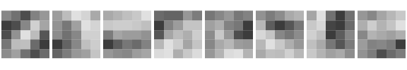

<!--
This article is precomputed: it needs protoc and the network, which
neither CRAN nor CI has. Edit onnx.Rmd.orig, never onnx.Rmd, and re-knit
from the package root with zuproto installed:

  Rscript -e 'setwd("vignettes/articles"); knitr::knit("onnx.Rmd.orig", "onnx.Rmd")'
-->


An [ONNX](https://onnx.ai/) model file is one Protocol Buffers message, a
`ModelProto`: the network's graph, its operators and every trained weight.
PyTorch, TensorFlow and scikit-learn all export to it, and runtimes from
phones to browsers load it. Because it is plain protobuf, zuproto can read
one without any machine-learning library. This article opens a small
handwritten-digit classifier and looks at its layers and weights.

The output below comes from a run on 27 October 2026.
The code is not run when the site is built.


``` r
library(zuproto)
```

## The schema

The schema is `onnx.proto`, from the [onnx](https://github.com/onnx/onnx)
repository. `protoc`, the protobuf compiler, turns it into a descriptor
set, which is what zuproto reads. zuproto itself does not need `protoc`:
on macOS, `brew install protobuf`; on Debian and Ubuntu,
`apt install protobuf-compiler`.


``` r
dir <- tempfile("onnx-")
dir.create(dir)
proto <- file.path(dir, "onnx.proto")
desc <- file.path(dir, "onnx.binpb")

download.file(
  "https://raw.githubusercontent.com/onnx/onnx/v1.23.2/onnx/onnx.proto",
  proto,
  quiet = TRUE
)
system2("protoc", c(
  paste0("--proto_path=", dir),
  paste0("--descriptor_set_out=", desc),
  proto
))
pool <- proto_pool(desc)
```

## The model

The model is MNIST from the [ONNX Model Zoo](https://github.com/onnx/models):
a small convolutional network that reads a 28 by 28 grey image of a digit.
The file is 26 kB.


``` r
model <- file.path(dir, "mnist-12.onnx")
download.file(
  paste0(
    "https://media.githubusercontent.com/media/onnx/models/",
    "c5cae0f1942c8d7727372c7b1f6b485aa39e4421/",
    "validated/vision/classification/mnist/model/mnist-12.onnx"
  ),
  model,
  mode = "wb",
  quiet = TRUE
)
m <- proto_decode(model, "onnx.ModelProto", pool, defaults = FALSE)
```

`defaults = FALSE` leaves out the fields the file does not set, which keeps
the result small. Everything except the graph is metadata: who wrote the
file, and which version of the ONNX operator set it uses.


``` r
str(m[names(m) != "graph"])
#> List of 6
#>  $ ir_version      : num 7
#>  $ opset_import    :List of 1
#>   ..$ :List of 2
#>   .. ..$ domain : chr ""
#>   .. ..$ version: num 12
#>  $ producer_name   : chr "CNTK"
#>  $ producer_version: chr "2.5.1"
#>  $ domain          : chr "ai.cntk"
#>  $ model_version   : num 1
```

## The graph as a table

The graph is a list of nodes. Each node applies one operator to named
inputs and writes named outputs, and the names wire the nodes together.
A data frame with one row per node reads like the network's layer list.


``` r
g <- m$graph
nodes <- data.frame(
  name = vapply(g$node, \(n) n$name, ""),
  op = vapply(g$node, \(n) n$op_type, ""),
  inputs = vapply(g$node, \(n) paste(n$input, collapse = ", "), ""),
  output = vapply(g$node, \(n) paste(n$output, collapse = ", "), "")
)
nodes[, c("name", "op", "inputs")]
#>                 name      op
#> 1      Convolution28    Conv
#> 2             Plus30     Add
#> 3             ReLU32    Relu
#> 4          Pooling66 MaxPool
#> 5     Convolution110    Conv
#> 6            Plus112     Add
#> 7            ReLU114    Relu
#> 8         Pooling160 MaxPool
#> 9  Times212_reshape0 Reshape
#> 10 Times212_reshape1 Reshape
#> 11          Times212  MatMul
#> 12           Plus214     Add
#>                                                     inputs
#> 1                                       Input3, Parameter5
#> 2                       Convolution28_Output_0, Parameter6
#> 3                                          Plus30_Output_0
#> 4                                          ReLU32_Output_0
#> 5                          Pooling66_Output_0, Parameter87
#> 6                     Convolution110_Output_0, Parameter88
#> 7                                         Plus112_Output_0
#> 8                                         ReLU114_Output_0
#> 9  Pooling160_Output_0, Pooling160_Output_0_reshape0_shape
#> 10               Parameter193, Parameter193_reshape1_shape
#> 11     Pooling160_Output_0_reshape0, Parameter193_reshape1
#> 12                         Times212_Output_0, Parameter194
```

Operator settings are attributes. A string attribute is `bytes` in the
schema, so it decodes to a raw vector.


``` r
conv <- g$node[[1]]
vapply(conv$attribute, \(a) a$name, "")
#> [1] "kernel_shape" "strides"      "auto_pad"     "group"        "dilations"
rawToChar(conv$attribute[[3]]$s)
#> [1] "SAME_UPPER"
```

## Inputs and outputs

A tensor's element type is an `int32` in the schema, holding a number from
the `TensorProto.DataType` enum. `proto_enums()` turns the number into its
name.


``` r
dtypes <- proto_enums(pool, "onnx.TensorProto.DataType")
head(dtypes)
#>        name number
#> 1 UNDEFINED      0
#> 2     FLOAT      1
#> 3     UINT8      2
#> 4      INT8      3
#> 5    UINT16      4
#> 6     INT16      5

describe <- function(v) {
  t <- v$type$tensor_type
  data.frame(
    name = v$name,
    type = dtypes$name[match(t$elem_type, dtypes$number)],
    shape = paste(vapply(t$shape$dim, \(d) d$dim_value, 0), collapse = " x ")
  )
}
do.call(rbind, lapply(c(g$input, g$output), describe))
#>               name  type           shape
#> 1           Input3 FLOAT 1 x 1 x 28 x 28
#> 2 Plus214_Output_0 FLOAT          1 x 10
```

The input is one image of one channel, 28 by 28 pixels; the output is ten
scores, one per digit.

## The weights

The trained weights are the graph's initializers, tensors stored in the
file. ONNX keeps the numbers in a typed field (`float_data`, `int64_data`)
or as packed little-endian bytes (`raw_data`); this file uses the typed
fields. A small helper turns either into an R array.


``` r
tensor_array <- function(t) {
  values <- if (length(t$raw_data) > 0) {
    readBin(t$raw_data, "double", n = prod(t$dims), size = 4, endian = "little")
  } else if (length(t$float_data) > 0) {
    t$float_data
  } else {
    t$int64_data
  }
  # ONNX stores tensors row-major, R arrays are column-major.
  if (length(t$dims) > 1) {
    aperm(array(values, rev(t$dims)))
  } else {
    values
  }
}

weights <- lapply(g$initializer, tensor_array)
names(weights) <- vapply(g$initializer, \(t) t$name, "")
shape <- \(w) paste(if (is.null(dim(w))) length(w) else dim(w), collapse = " x ")
vapply(weights, shape, "")
#>                       Parameter193                        Parameter87 
#>                  "16 x 4 x 4 x 10"                   "16 x 8 x 5 x 5" 
#>                         Parameter5                         Parameter6 
#>                    "8 x 1 x 5 x 5"                        "8 x 1 x 1" 
#>                        Parameter88 Pooling160_Output_0_reshape0_shape 
#>                       "16 x 1 x 1"                                "2" 
#>        Parameter193_reshape1_shape                       Parameter194 
#>                                "2"                           "1 x 10"
sum(lengths(weights))
#> [1] 5998
```

The network has under six thousand weights. The first convolution has eight
filters of 5 by 5 pixels; drawn as images, they are the patterns the
network looks for in a digit.


``` r
filters <- weights[["Parameter5"]] # 8 x 1 x 5 x 5
op <- par(mfrow = c(1, 8), mar = c(0.2, 0.2, 0.2, 0.2))
for (k in 1:8) {
  w <- filters[k, 1, , ]
  image(t(w[5:1, ]), col = gray.colors(32), axes = FALSE, asp = 1)
}
```

<div class="figure">

<p class="caption">plot of chunk filters</p>
</div>

``` r
par(op)
```

## Writing a model back

`proto_encode()` is the inverse of `proto_decode()`. Here the model gains
a description and a metadata entry, and is written to a new file. ONNX's
own checker accepts the file, and onnxruntime gives the same scores for it
as for the original.


``` r
m$doc_string <- "MNIST digit classifier, annotated in R"
m$metadata_props <- list(list(key = "source", value = "ONNX Model Zoo"))
out <- file.path(dir, "mnist-annotated.onnx")
writeBin(proto_encode(m, "onnx.ModelProto", pool), out)

again <- proto_decode(out, "onnx.ModelProto", pool, defaults = FALSE)
again$doc_string
#> [1] "MNIST digit classifier, annotated in R"
identical(again$graph, m$graph)
#> [1] TRUE
```
